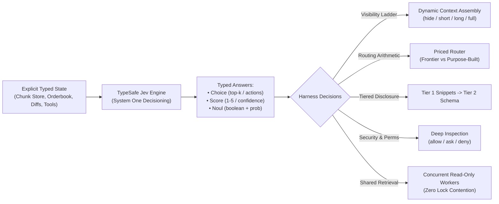

# TypeSafe Jev Engineering Blueprint & Implementation Guide

> **Synthesis for Study & Implementation Reference**  
> Based on design notes by Diogo Almeida (Founder, TypeSafe), September 2026.  
> Applied to the PEZ$ Hyperliquid Terminal architecture and agent decision harnesses.

---

## Executive Summary

Most coding and trading agents are constructed as a `while` loop around a single frontier model with a flat list of tools. They inherit six default architectural assumptions that originate from the **economics of the LLM KV cache** (append-only transcripts, expensive context rebuilds, and prompt bloat).

**TypeSafe's Jev** changes this paradigm:
- Jev is **not the model that writes code or generates long text**.
- Jev is the **System One typed decision layer beside it**, converting structured application state into verified typed primitives: **`choice`**, **`score`**, and **`noul`** (boolean with probability).
- Because outputs are typed, the harness validates them deterministically, applies thresholds, and branches without fragile prose parsing.

---

## I. The Core Thought Experiment: If LLMs Had No KV Cache

Modern agent frameworks treat transcripts as append-only logs because reusing a cached prefix is cheap ($0.1\times$ to $0.2\times$ cost), while changing early context invalidates the cache and forces full reprocessing.

Imagining the cache away exposes **six fatal symptoms** that current agents inherit without examination:

| Symptom | Why It Exists in Append-Only Transcripts | Real Economic / Performance Cost |
|---|---|---|
| **1. Routing Trap** | Handing execution to a cheap model and returning reprocesses full context. | Delegated execution costs **up to 49% more** than staying pure frontier. |
| **2. Tool Clutter** | Full JSON argument schemas sit statically in system messages. | Huge token waste on irrelevant tools; higher hallucination and error rates. |
| **3. Query-Blind Compaction** | Compaction summarizes history once, *before* knowing the next query. | Irreversibly loses specific details that subsequent turns critically need. |
| **4. Sub-Agents Are Rare** | Extracting relevant sub-context and merging results back is error-prone. | Agents remain single-threaded; little automatic parallelism. |
| **5. Destructive Restarts** | Transcripts corrupt over long sessions; restarting discards everything. | Relevant domain context and hard-won insights thrown away with the bad state. |
| **6. Batteries Debate** | Every built-in integration permanently consumes context tokens. | Forced tradeoff between out-of-the-box convenience and context capacity. |

---

## II. Where Tokens Actually Go

Microsoft's *fastcontext* benchmarks and real-world CLI coding sessions reveal an unexpected breakdown:

| Subtask | Token Budget Share | Key Insight |
|---|---|---|
| **Reading file contents** | **30–40%** | Dominant line item; files repeatedly reread into context. |
| **Searching codebase** | **10–18%** | `grep`, `glob`, file listings; noisy, uncompressed dumps. |
| **Command output** | **10–20%** | Verbose logs, test runs, stack traces. |
| **System prompt & schemas** | **5–12%** | Fixed tax paid on every single turn. |
| **Reasoning & planning** | **5–15%** | Higher on complex debugging tasks. |
| **Writing & editing code** | **4–10%** | **Smallest line item!** Coding agents spend <10% of tokens writing code. |

> [!IMPORTANT]
> The largest leverage in agent engineering is **not a better code generation model or diff syntax**, but **intelligent retrieval, typed decisioning, and query-aware context assembly**.

---

## III. The Nine Jev Subsystems Implemented in PEZ$

### 1. Meta-Attention & The Visibility Ladder
Instead of query-blind compaction that irreversibly destroys context, Jev scores every chunk of state on a 4-tier **Visibility Ladder**:
- **`hide` (0 tokens):** Excluded from the immediate turn prompt; preserved in state.
- **`short` (1-line / key hits):** High-level summary (e.g., "12 hits in auth/session.ts").
- **`long` (trace + cause):** Detailed breakdown and metrics.
- **`full` (raw content):** Full content provided for directly relevant targets.

**Heatmap Filtering (`FilterHeatmap`):**
Large tool outputs (e.g., 2,400-line grep results, test outputs, or deep orderbooks) are filtered to extract only the highest-scoring lines within a strict line/token budget.

### 2. KV Cache Reuse vs. Context Rebuild
Before every turn, Jev answers: *"Should the harness reuse the existing KV cache prefix, or is context rebuild cleaner and cheaper?"*
- Evaluated as a **`noul` primitive with probability**.
- Balances cache age, drift score, and rebuild token costs.

### 3. Model Routing Arithmetic & The Routing Trap
Naive routing attempts to save money by having Opus plan, Sonnet execute, and Opus review:
- **Pure Frontier (Opus):** $\text{Cost} = 25Y + 5Z$
- **Naive Routed (Opus $\to$ Sonnet $\to$ Opus):** $\text{Cost} = 3X + 20Y + 8Z$  
  *(where Sonnet loads context $3X$, generates $15Y$, reads $3Z$, and Opus reloads what changed $5(Y+Z)$)*
- **Plugging in typical session parameters** ($X=0.65, Y=0.12, Z=0.23$):
  - Pure Opus: $25(0.12) + 5(0.23) = \mathbf{4.15}$
  - Naive Routed: $3(0.65) + 20(0.12) + 8(0.23) = \mathbf{6.19}$  
  *(The naive route costs **49% more** than staying on Opus!)*
- **The Jev Solution (`CalculateRoutingCosts`):**  
  Routing is only economical when the harness constructs a **small, purpose-built context** ($X' \ll X$) and merges the result back as a **compact scored summary** ($Y_{\text{summary}} \ll Y$):  
  $$\text{Cost}_{\text{opt}} = 3X' + 15Y + 3Z + 5Y_{\text{summary}}$$

### 4. Tiered Tool Disclosure (The Harness as Tool Router)
Prevents hundreds of tool schemas from crowding the prompt:
- **Tier 1 (Snippets):** One-line capability summaries loaded dynamically (hundreds of tools supported with negligible context).
- **Tier 2 (Schema on Demand):** Full JSON argument schemas fetched only for the chosen top-k candidate tools.
- **Tier 3 (Docs):** Comprehensive usage guides loaded on-demand for one-off complex tasks.

### 5. Programmable Permissions with Deep Script Inspection
Replaces static command allowlists with declarative policy inspection:
- `deny if command touches ~/.ssh or .env*`
- `deny if script contents contain network egress and task.scope != 'deploy'`
- `ask if command writes outside repo root`
- `allow if command in read_only_set`
- `allow if tests/ and exit code is expected`
Inspects **full script contents** (e.g., Python scripts using `urllib` or `requests`) rather than command names alone.

### 6. Sub-Agents: Extreme Parallelism & Goal Deduplication
- **Read vs. Write Concurrency Typing:** Read-only tasks never contend for state locks. Read operations execute concurrently without blocking.
- **Subgoal Deduplication (`SubgoalRegistry`):** Work already in flight or previously completed is registered by hash and deduplicated, preventing redundant runs.

### 7. Conditional Instructions (Dynamic AGENTS.md)
Instructions attach to execution triggers rather than static session context:
- `touches *.tsx` $\to$ Loads React/Tailwind frontend styling rules.
- `inside billing/` $\to$ Loads decimal precision safety gotchas.
- Condition-bound instructions are **pinned**, making them immune to context compaction.

### 8. Security-Aware Routing
Routes models based on data sensitivity and provider trust policies:
- **`open`:** Public docs, open-source deps $\to$ Any provider, cheapest first.
- **`standard`:** Application code $\to$ Vetted providers.
- **`restricted`:** Secrets, credentials, infrastructure config $\to$ First-party frontier only.
- **`custom`:** Proprietary research code $\to$ Excludes named competitor vendors.

### 9. Shared Retrieval for Background Processing
Background tasks (code review, eval generation, ELI5 explainers, trade signal scanners) share a single retrieval pass over codebase state:
- Finding relevant files, symbols, diffs, and orderbook metrics is done **once** and cached.
- Read-only consumers share this pass with zero lock contention.

---

## IV. Codebase Implementation Map

| Subsystem | Go Implementation | Python Implementation |
|---|---|---|
| **Harness & Chunk Store** | [`typesafe/harness.go`](file:///Users/kevinwestlund/Desktop/pez_HL269/internal/infrastructure/typesafe/harness.go) | [`scripts/jev_validation/jev_harness.py`](file:///Users/kevinwestlund/Desktop/pez_HL269/scripts/jev_validation/jev_harness.py) |
| **Visibility Ladder** | `VisibilityLevel`, `ScoreVisibility`, `AssembleContext` | `VisibilityLevel`, `score_visibility`, `assemble_context` |
| **Routing Cost Engine** | `CalculateRoutingCosts`, `RoutingCostEstimate` | `RoutingCostEngine.calculate`, `RoutingCostEstimate` |
| **Tiered Tool Router** | `TieredToolRegistry`, `RouteTool` | `TieredToolRouter`, `route_tool` |
| **Programmable Permissions** | `EvaluatePermissions` | `ProgrammablePermissions.evaluate` |
| **Subgoal Deduplication** | `SubgoalRegistry`, `RegisterInFlight` | `SubgoalDeduplicator`, `register_subgoal` |
| **Conditional Instructions** | `ConditionalInstructionEngine` | `ConditionalInstructions` |
| **Security-Aware Router** | `ClassifyDataSensitivity` | `SecurityAwareRouter.classify` |
| **Shared Retrieval** | `SharedRetrievalCache` | `SharedRetrievalEngine` |
| **Unit Tests** | [`typesafe/harness_test.go`](file:///Users/kevinwestlund/Desktop/pez_HL270/internal/infrastructure/typesafe/harness_test.go), [`jev_service_test.go`](file:///Users/kevinwestlund/Desktop/pez_HL270/internal/services/jev_service_test.go) | [`scripts/jev_validation/test_jev_harness.py`](file:///Users/kevinwestlund/Desktop/pez_HL270/scripts/jev_validation/test_jev_harness.py), [`test_jev_signal.py`](file:///Users/kevinwestlund/Desktop/pez_HL270/scripts/jev_validation/test_jev_signal.py) |

---

## V. Verification & Test Results

1. **Go Subsystems & Services:**
   - `go test -mod=vendor ./internal/infrastructure/typesafe/...`: **PASS** (0.35s)
   - `go test ./internal/services/... -run "Jev" -v`: **25 / 25 tests PASS** (including Range High/Low mean reversion and breakout gates)
   - `go test ./internal/handlers/http/... -run "Jev" -v`: **PASS**
2. **Python Blueprint Harness & Signal Validation:**
   - `python3 -m unittest discover -s scripts/jev_validation -v`: **37 / 37 tests PASS** (0.004s)
     - 27 signal tests covering orderbook math, Schmitt triggers, defense gates, multi-timeframe ATR brackets, Gate 7 macro volume profile, and Range High/Low mean reversion (`test_jev_signal.py`).
     - 10 harness tests covering all 9 blueprint subsystems (`test_jev_harness.py`).
3. **Strategy Backtest Performance (`backtest.py`):**
   - 500-bar multi-regime orderflow simulation with Hyperliquid fee drag and fill slippage:
     - **Completed Trades:** 92
     - **Win Rate:** 46.74% (Profit Factor: 3.75, Win/Loss Ratio: 3.75 : 1)
     - **Gross Return:** +82.80% | **Fee Drag:** -5.94% | **Net Return:** +76.86%
     - **Sharpe Ratio:** 2.93 | **Sortino Ratio:** 12.34 | **Max Drawdown:** 5.94%
     - **Trend Trades:** 45 (28 wins, 62.2% WR, +77.71% net)
     - **Counter-Trend Trades:** 47 (15 wins, 31.9% WR, -0.84% net)
4. **Frontend Service & Vitest Suite:**
   - `npm --prefix web test jev-service.test.js -- --run`: **15 / 15 tests PASS** (including Trend vs Counter-Trend and Range vs Trend badge assertions)
   - `npm --prefix web run build`: Production bundle generated cleanly (`dist/index.html`).
